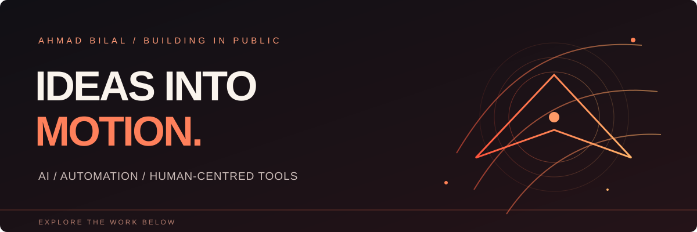

### Hey, I’m Ahmad.

I’m curious about what happens when ambitious ideas meet real-world work. I explore AI, automation and digital products — learning by building, testing and asking better questions along the way.

**Take a look around ↓**

---

### 01 / The work

<b>JugaDO-B</b> &nbsp; ↗ &nbsp; AI operations, with people in control

 
An exploration of a governed AI employee operating system, built on OpenWorker. The question behind it: how can AI help with work while people remain in charge?
  
<a href="https://github.com/sb2407441-bit/JugaDO-B"><b>Explore JugaDO-B →</b></a>
  

<b>ProofPilot</b> &nbsp; ↗ &nbsp; Better research, grounded in sources

 
A workspace for opportunity eligibility, funding review and application drafting, with optional local AI. Built around keeping the source material in view.
  
<a href="https://github.com/sb2407441-bit/ProofPilot"><b>Explore ProofPilot →</b></a>
  

### 02 / The curiosity

**AI agents** &nbsp; · &nbsp; **Useful automation** &nbsp; · &nbsp; **Digital products** &nbsp; · &nbsp; **Human-centred technology**

<b>What connects it all?</b>

 
I’m interested in turning messy, everyday challenges into tools people can actually use — and learning what works through the process.
  

---

BUILT WITH CURIOSITY &nbsp; / &nbsp; ALWAYS IN PROGRESS
